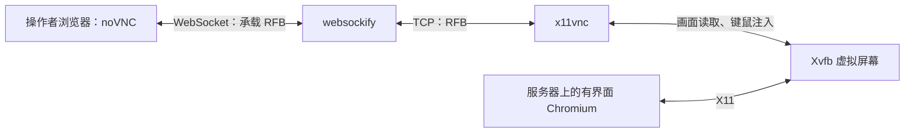
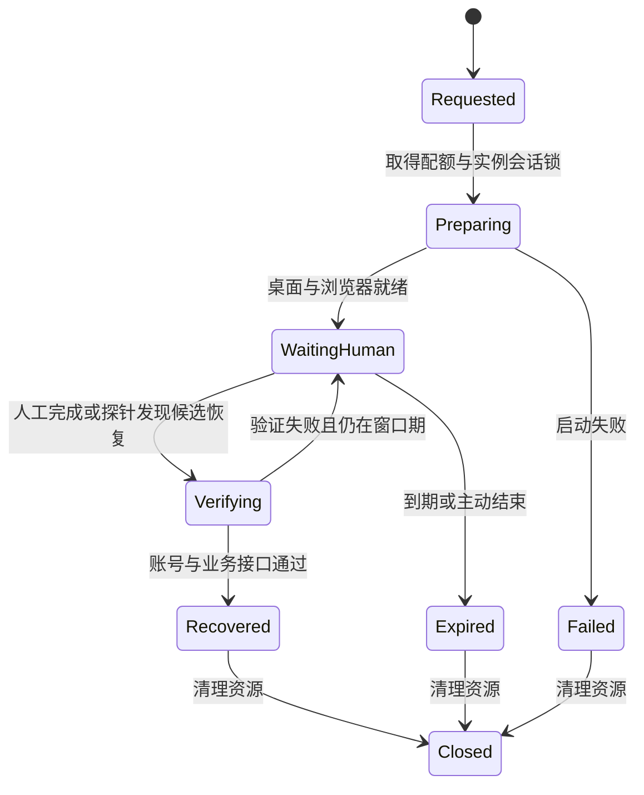

# noVNC 实现分析与改造方案

日期：2026-10-25。范围：小小糯项目的人工登录、验证码处理与远程浏览器运维。

## 1. 建议

保留 noVNC + websockify + x11vnc + Xvfb，先整理为“按需启动的人工处理会话”。第一阶段采用 SSH 隧道访问，为 A/B/C 配置独立桌面和凭据路径，统一人工处理入口，验证真实业务恢复后再结束会话。初期全机最多同时开启一个人工浏览器，其他实例排队；资源验证通过后再决定是否放开并行。

本方案基于本地源码、2026-10-20 的部署记录及本次读取的上游官方文档。没有登录服务器、检测当前公网端口或执行真实验证码流程。历史记录中的服务状态、硬件容量和地址不能当作当前线上事实。

## 2. noVNC 是怎么工作的



- **Xvfb**：Linux 没有显示器时，提供一块内存中的虚拟屏幕，例如 `:99`。
- **Chromium**：通过 `DISPLAY=:99` 把浏览器窗口绘制到虚拟屏幕；仍在服务器上运行、从服务器或配置的代理访问目标网站。
- **x11vnc**：读取屏幕变化，通过 VNC/RFB 协议发送画面，并把远程键鼠事件注入该屏幕。
- **websockify**：在 WebSocket 和 TCP 之间双向转发字节流。本身不负责浏览器登录、画面编码或验证码判断。
- **noVNC**：浏览器中的 JavaScript VNC 客户端，处理 RFB、渲染画面、采集键鼠事件。用户无需安装桌面客户端。

这传输的是远端桌面的画面和输入事件。网页实际运行在远端 Chromium，网站收到的网络请求也来自远端浏览器使用的出口。验证码由人完成，noVNC 只提供操作通道。

## 3. 项目当前接法

| 环节 | 本地实现 | 说明 |
| --- | --- | --- |
| 桌面启动 | `tools/ops/start_vnc.sh` | 启动 Xvfb `:99`、x11vnc `5900`、websockify `6080`，静态页面目录 `/opt/noVNC` |
| 服务管理 | `tools/ops/dzmm-vnc.service` | `Type=forking`、`RemainAfterExit=yes`，执行宿主机 `/opt/dzmm/start_vnc.sh` |
| 容器显示 | `docker-compose.prod.yml` | A/B/C 都设置 `DISPLAY=:99`，并挂载宿主机 `/tmp/.X11-unix` |
| 登录失败转人工 | `headless_relogin.py` | 后台启动 `--manual-captcha`，默认等 10 分钟；读取 `pw_captcha`，拿到 Cookie 后通过 `token_store` 写回 |
| 风控转人工 | `captcha_novnc.py` | 使用独立 `pw_captcha`，默认等 30 分钟；无人处理则每 30 分钟探测，最长再等 3 小时 |
| 触发点 | `runtime/mainloop.py`、`renew_token.py` | 两处可后台拉起 `captcha_novnc.py` |
| 告警 | 两个人工处理脚本 | 读取 `VNC_URL`、`VNC_PASS`，目前会把地址和密码放入通知文本 |

A/B/C 的 profile 与 token 挂载目录已有区分，可继续利用；画面通道仍共用 `:99`。多个实例同时打开浏览器时，窗口和操作会落在同一个桌面上。

2026-10-20 部署记录还记载过一套临时桌面：远端仅绑定回环地址，经 SSH 隧道访问，处理后关闭。该记录明确说明它已关闭，不能直接把留档地址当成有效入口。临时白屏曾通过禁用 Xvfb MIT-SHM、给 x11vnc 增加 `-noxdamage -noshm`、给 Chromium 增加 `--disable-gpu --ozone-platform=x11` 修复。这些属于兼容性候选配置，正式化前应重现并验证。

## 4. 应先解决的问题

| 问题 | 源码依据 | 改造目标 |
| --- | --- | --- |
| 桌面监听没有显式收敛 | 启动脚本未给 x11vnc 加 `-localhost`，websockify 只指定 `6080` | 两层都绑定回环；实际公网可达性还取决于服务器防火墙、安全组，需上线时核验 |
| 重启范围过大 | 脚本使用 `pkill -f x11vnc/websockify` | 按实例和会话管理自己的 PID/cgroup，避免结束其他临时桌面 |
| 子进程故障可能不被发现 | 三个程序通过 `nohup ... &` 启动，systemd 未分别跟踪它们 | 一个组件退出就能被发现、重启或使本会话明确失败 |
| 多入口争抢人工 profile | 两条路径都使用 `pw_captcha`，但 `captcha_novnc.py` 没有人工会话级互斥 | 每实例只允许一个人工会话，重复请求返回现有会话 |
| 盲删 Chromium 锁 | 两条路径启动前都清理 `Singleton*` | 先确认 profile 没有活跃拥有者，只清理确认残留的锁 |
| 恢复判断不足 | `captcha_novnc.py` 看到输入框就调用 `auto_resume`，没有在此分支校验业务 API，也没有写回该浏览器的新凭据 | 根据故障类型验证账号、凭据和真实业务接口；满足条件才报成功 |
| 残留 Cookie 可能误判登录 | `login_manual_captcha` 的等待循环仅判断 token Cookie 是否存在 | 检查时效及服务端有效性，避免旧 Cookie 立刻触发“成功” |
| 探针过于宽松 | `ip_captcha_cleared()` 会把非 418、非 captcha 重定向的其他响应视为通过，例如 500 | 明确区分正常响应、风控、认证失败、服务异常与网络异常；首页结果只作辅助 |
| 暂停状态语义陈旧 | 主循环已写明遇风控不写 `bot.paused`、继续收发；人工脚本仍通知“bot 已暂停”，并无条件尝试删除暂停文件 | 描述实际受影响能力；只能清除本会话拥有、且确实已解除的暂停原因 |
| 通知泄露长期入口凭据 | 通知包含 `VNC_PASS` | 通知只发实例、原因、会话状态和操作入口，密码由受限本地文件提供 |

## 5. 第一阶段架构

### 5.1 入口和访问

提供一个本地运维脚本 `tools/ops/novnc_tunnel.ps1`，命令形式建议为：

```powershell
.\tools\ops\novnc_tunnel.ps1 -Instance A
.\tools\ops\novnc_tunnel.ps1 -Instance A -Stop
```

这是拟新增的命令，目前还不能执行。脚本通过 SSH 调用固定的远端管理命令，准备指定实例桌面，检查就绪，再建立隧道并打开网页。它要验证占用本地端口的是否为自己的隧道，并保存自己的进程标识，结束时只清理本会话。

第一阶段可保留 noVNC 原有页面，顶部增加明确的实例和会话状态提示；不必先开发一个完整管理平台。远端 VNC 和 websockify 均绑定 `127.0.0.1`，传输经 SSH 加密。VNC 密码保存于按实例划分的受限文件，不进入 URL、通知、命令参数或 Git。

### 5.2 实例隔离

以下为建议分配，执行前要检查端口和 display 占用：

| 实例 | 虚拟屏幕 | 远端 VNC | 远端 noVNC | 本地入口 |
| --- | --- | --- | --- | --- |
| A | `:199` | `127.0.0.1:5911` | `127.0.0.1:16081` | `127.0.0.1:16080` |
| B | `:200` | `127.0.0.1:5912` | `127.0.0.1:16082` | `127.0.0.1:16082` |
| C | `:201` | `127.0.0.1:5913` | `127.0.0.1:16083` | `127.0.0.1:16083` |

人工 worker 在对应 bot 容器里运行，沿用该实例的网络代理、origin、UA、profile 和 token 路径，单独覆盖人工 worker 的 `DISPLAY`，无需把整个 bot 的显示都切过去。

独立 display 能避免窗口混在一起，但还不是完整访问隔离。应配置每实例 Xauthority，仅向对应容器提供所需 X socket 和授权文件；最终收窄现有整目录 X11 挂载。不要通过 `xhost +` 绕过授权。宿主机与容器的文件权限、UID 及 socket 重建后的可见性要一起验证。

### 5.3 生命周期

宿主机管理 Xvfb、x11vnc、websockify，容器内 worker 管理 Chromium。使用 systemd 模板单元及依赖关系，或一个前台 supervisor，让所有子进程都有明确所有者和故障上报。宿主机仅执行白名单实例和固定启动命令；网页与 bot 不获得通用 Docker socket 或任意命令执行能力。

- 每实例一把人工会话锁，记录 `session_id`、实例、故障类型、开始时间和截止时间。
- 初期增加全局人工浏览器配额：同一时刻一个，其余排队；先实测 CPU/RSS、现有 bot 内存余量，再调整。
- 启动顺序：配额与会话锁 → Xvfb 就绪 → x11vnc 就绪 → WebSocket 桥就绪 → Chromium 出现可操作页面 → 发出就绪通知。
- 人工窗口默认 30 分钟，可主动结束；到期关闭浏览器、VNC、websockify 和虚拟屏幕。超时关闭由独立 timer/监督进程保证，不能只依赖网页关闭事件。
- 后台业务探测是独立任务，不需要持续保留人工桌面；成功、超时、异常、主动结束都必须释放资源。
- 同一实例重复触发时复用现有会话，不重复开窗口或刷通知。

“30 分钟有效”应同时约束已有连接和重新连接的能力；只关闭 Chromium 但保留远程桌面监听，并不等于入口已经失效。

## 6. 统一恢复流程



统一入口接收 `instance` 和 `reason`。至少区分 `ip_challenge` 与 `session_login`：前者不一定需要重新登录，后者必须验证并保存可用登录态，避免一遇风控就反复密码登录。

验证步骤：

1. 人工完成页面操作，页面元素变化只触发候选验证。
2. 对 IP 风控，先用对应实例当前生产凭据调用真实只读业务 API；若已经恢复，不必覆盖凭据。
3. 需要更新凭据时，在人工浏览器上下文中验证登录态，并通过平台提供的身份接口确认是该实例预期账号。Cookie 保留范围根据目标站实际依赖确定，不能假设仅复制一个 token 就转移了完整风控状态。
4. 使用现有 `session_guard`/`token_store` 整合写回流程。人工会话使用独立 lease，让自动重登避让；凭据锁只保护必要的验证与写入，并按统一锁顺序执行。写入前检查会话版本，防止覆盖期间产生的更新凭据。
5. 从该实例的实际运行环境读取写回结果，重新验证真实只读业务 API，随后观察 bot 的受影响通道恢复。HTTP、Socket.IO 和浏览器发送分别记录状态，不能用首页 200 宣布所有功能恢复。
6. 只清除当前故障拥有的退避/暂停状态；保留其他人工暂停原因。发出一次完成通知并清理桌面资源。

如果浏览器能访问但 bot API 仍被风控，应报告“人工页面通过，业务接口未恢复”，保留失败类型继续排查。网站风控可能同时依赖 Cookie、出口与浏览器特征，不能承诺任意一次滑块完成就一定解除所有通道。

## 7. 文件改动范围

| 文件 | 计划改动 |
| --- | --- |
| `tools/ops/start_vnc.sh` | 参数化实例/display/端口；回环绑定；就绪检查；去掉全局 pkill 与固定 sleep 判断 |
| `tools/ops/dzmm-vnc.service` 及新增模板单元/监督脚本 | 实例生命周期、子进程故障、超时回收、定向清理 |
| 新增 `tools/ops/novnc_tunnel.ps1` | 本地一键准备桌面、建立隧道、打开网页和主动结束 |
| 新增 `runtime/manual_session.py` | 会话状态、去重、人工 lease、截止时间、结构化错误 |
| `captcha_novnc.py` | 接入统一 worker；替换输入框即成功的判断；修正状态通知与暂停清理 |
| `headless_relogin.py` | 人工路径复用统一入口；验证 Cookie 与账号；防止活跃 profile 被清锁 |
| `renew_token.py`、`runtime/mainloop.py` | 发起统一会话请求并遵守人工 lease，避免重复 Popen；保持按实际故障降级 |
| `docker-compose.prod.yml` | 每实例显示授权和必要挂载；不再向 bot 注入用于通知的长期 VNC 密码 |
| `admin/dashboard.py` | 如需展示，只增加只读会话状态；启动/关闭能力留给独立运维入口 |

当前后台明确设计为只读，不建议把远程控制接口直接塞进它。第二阶段若需要手机直接点击通知访问，再单独设计 HTTPS/WSS 运维入口：管理员认证、静态页面与 WebSocket 一并授权、Origin 校验、会话到期主动断连。仅保护网页而漏掉 WebSocket 端点是不完整的。

## 8. 落地顺序与验收

**第一步：本地整理与测试。** 实现统一会话、业务验证和定向进程管理；以假 VNC/可控进程验证异常回收，以模拟业务响应验证恢复分支。此阶段不触碰生产凭据或发送真实通知。

**第二步：单实例试运行。** 先只选 A。部署前核验真实服务单元、端口、内存、挂载和浏览器拥有者，保存原文件及可恢复配置。验证空白桌面、键鼠与显示兼容性，再由人工完成真实登录/验证码，最后验证对应账号业务 API。涉及 compose 挂载变化时安排该实例重建窗口。

**第三步：扩展 B/C。** 逐个实例切换并核对身份、profile、token 路径、Xauthority 和桌面隔离。完成后清退旧共用 `:99` 的人工入口；遇到问题回退受影响实例，回退时保留已轮换的受限凭据及回环访问方式。

上线验收必须覆盖：

- 远端 VNC/noVNC 只在回环监听；外部不能直连；本地 SSH 隧道可以操作远端浏览器。
- A/B/C 不串屏、不串账号、不互相改写 token；当前未处理实例的 bot 功能保持正常。
- 同一实例重复触发只产生一个会话；多个实例请求符合全局配额策略。
- 任一桌面组件被终止后，会话能正确失败或受控重启；不会误杀其他桌面及 bot。
- 旧 Cookie、错误账号、HTTP 500、网络超时、首页正常但成员 API 失败，都不能报恢复。
- 人工成功后，从 bot 环境验证业务 API；通知不把仍在降级的通道称为恢复。
- 到期与主动结束会断开已有连接并阻止重连；异常退出后没有遗留浏览器、监听端口或失效锁。
- 现有人工暂停标记不会被本会话无条件删除；通知与日志不含密码、Cookie 或 token。

估算：在现有宿主机组件可复用、无需额外网络适配的条件下，第一阶段实现及本地验证约 1–2 个工作日，单实例生产联调另留半天；多实例推广与可选 HTTPS 入口分别评估。真实验证码出现时机和当前服务器资源尚未核验，不计入可保证的完成时间。

## 9. 参考

- noVNC 官方说明：https://github.com/novnc/noVNC
- noVNC RFB API：https://github.com/novnc/noVNC/blob/master/docs/API.md
- websockify 官方说明：https://github.com/novnc/websockify
- 本项目临时桌面记录：`docs/姐妹图集-部署记录-2026-10-20.md`

上游文档本次已在线读取，用于核实协议与组件职责；线上安装版本需部署前另行确认。
